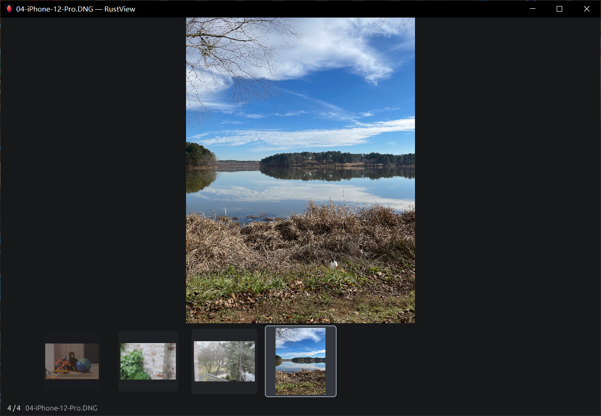
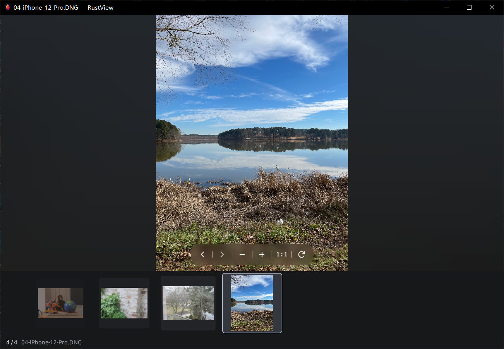
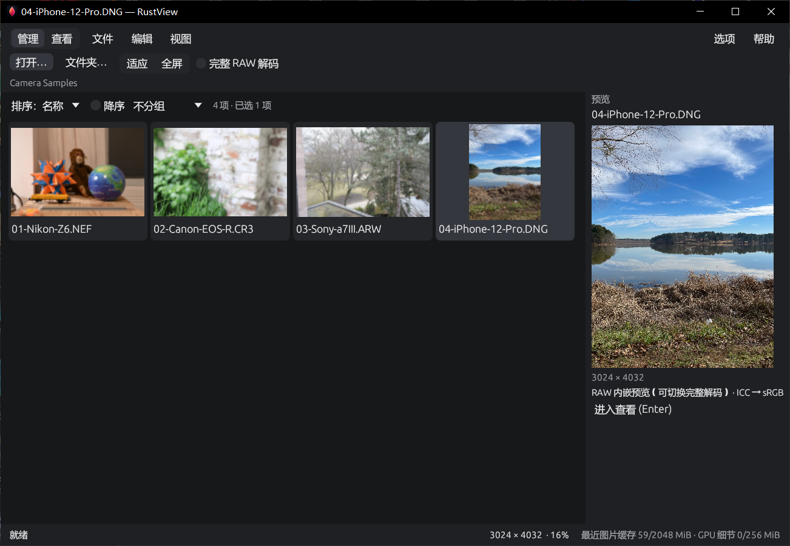
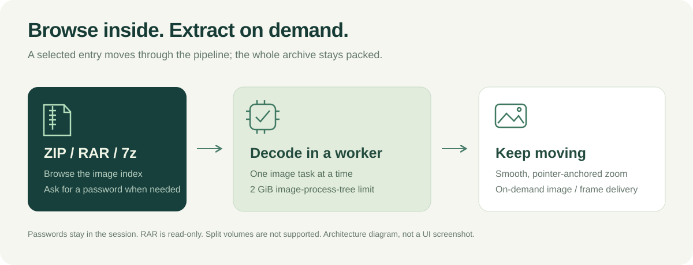
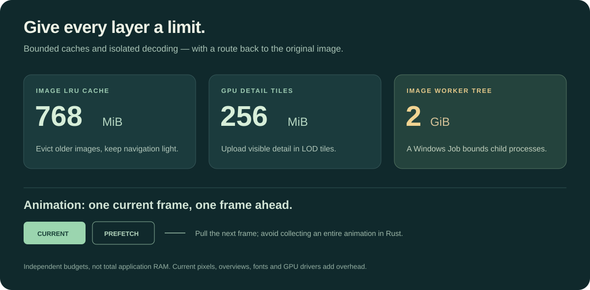

# RustView


[](https://github.com/walker1911/RustView/actions/workflows/ci.yml)

**打开压缩包，接着看。**

面向 **Windows x64** 的 Rust 看图项目。用熟悉的快捷键、Picasa 式胶片带和平滑缩放浏览相机 RAW、静态 SVG、GIF/WebP 动画、Photoshop 合成图及 ZIP／RAR／7z 里的照片。看图时也能直接读二维码、复制图片里的文字。

[下载 v0.7.6](https://github.com/walker1911/RustView/releases/tag/v0.7.6) · [English](README.en.md) · [兼容说明](docs/COMPATIBILITY.md) · [构建指南](BUILDING.md)

## v0.7.6 兼容性修复

**打开带 `DOCTYPE` 的静态 SVG 1.1。** 接受不含内部 DTD 子集的声明，常见的 `PUBLIC` 和 `SYSTEM` 声明均可离线打开。外部 DTD 和资源不会加载，自定义 XML 实体不会展开。[v0.7.6 更新说明](docs/RELEASE-v0.7.6.md)

## 静态 SVG 与 v0.7.5 实测

**直接看静态 SVG。** 双击已关联的本地 `.svg`，或拖入窗口即可打开。文件夹和 ZIP／RAR／7z 中的 SVG 均可浏览和预览缩略图，加密压缩包按需输入密码。透明区域使用固定棋盘格。

**放大停稳后补清晰。** 连续缩放时沿用当前画面，停稳约 140 ms 后按需在后台用 resvg 渲染更清晰的画面，保留缩放和位置。支持 8 MiB 以内的 UTF-8 静态 SVG。渲染长边最多 4,096 像素、总面积最多 800 万像素，外部资源会跳过。

| 同一台 Windows 电脑的实测中位数 | v0.7.4 | v0.7.5 |
|---|---:|---:|
| OneDrive 桌面首图可见，JPEG／PNG | 492／586 ms | 500／498 ms |
| 本地目录首图可见，JPEG／PNG | 471／502 ms | 505／513 ms |
| 万张 JPEG 目录，首张清晰图 | 531 ms | 539 ms |
| 混合相机 RAW，首张清晰图 | 525 ms | 519 ms |
| 长按翻到目标图预览，JPEG／RAW | 19.8／11.6 ms | 19.1／11.4 ms |
| 松开方向键后显示清晰图，JPEG／RAW | 19.6／289.8 ms | 17.9／281.3 ms |

本地 JPEG 两版各自的中位数相差约 35 ms，同一轮内逐对计算的中位差约 −2 ms，首图有波动。长按翻图未采到空白帧。应用及其工作进程的私有提交内存采样峰值在 JPEG 测试中为 426.6 → 429.0 MiB，在 RAW 测试中为 510.2 → 512.5 MiB。[v0.7.5 更新说明、测试方法与详细数据](docs/RELEASE-v0.7.5.md)

## 本地目录浏览

**从最近打开的文件夹续看。** 在 **「文件 → 最近打开…」** 中点击文件夹，回到上次显示的图片。点击 **「从头打开」** 则从第一张开始。浏览中改名会更新续看位置。上次图片在关窗后改名或被删除时，从第一张开始。新图还未显示就关窗，会保留上次的位置。[v0.7.4 更新说明](docs/RELEASE-v0.7.4.md)

**在本地文件夹快速跳图。** 单图查看时移到窗口顶边，打开工具栏的 **「跳页…」**，按文件名或当前浏览序号找图。跳转后，左右键从这张图继续翻看。Windows 实测包含在万张 JPEG 目录中跳到第 6,800 张。[v0.7.2 更新说明与实测数据](docs/RELEASE-v0.7.2.md)

**首图出现后，能更早翻到旁边的照片。** 双击本地图片时仍先出首图。RustView 先让前后各最多 8 张图片可翻，再完成全目录的排序和索引。按得早也会暂存方向键操作，等相邻图片可用后切换。在同一万张 JPEG 目录里，首图刚出现时只按一次左键或右键，v0.7.1 成功 8／8 次，v0.7.0 为 0／8 次。[v0.7.1 更新说明与实测数据](docs/RELEASE-v0.7.1.md)

**外部保存后，接着看同一个位置。** RustView 会自动刷新正在浏览的本地目录。添加、移走、重命名或保存图片后，文件列表和缩略图会跟着更新。当前图被重新保存时，会在原位置重读，保留缩放和平移。文件尚未写完时先保留原画面，长按翻图时等浏览停下来再更新目录。[v0.7.0 更新说明与实测数据](docs/RELEASE-v0.7.0.md)

## 图上选字、超大 TIFF 与 Photoshop 预览

**直接在图片上选字。** 在静态图上停留片刻，RustView 会在后台离线识字。鼠标移到文字上出现文本光标后，可拖选一段或多行，再按 `Ctrl+C`。包内提供简体中文和英文模型，右键仍可调用整图、框选识别。[OCR 结果实拍](assets/readme/ocr-result.png)

**缩放超大 TIFF。** 打开符合条件的本地金字塔 TIFF 或 BigTIFF，先看内嵌全景，再随着缩放和平移按需读取视野内的细节分块。超出常规预算的文件进入只读查看模式。[TIFF 支持范围](docs/COMPATIBILITY.md)

**改进 PSD 预览和翻图。** PSD/PSB 可读取 ZIP 压缩的合成图，包括带预测编码的文件。复杂文档缺少可用的合成图时，如有内嵌 JPEG，可显示带标记的预览。点按翻图时，小 JPEG 可直接显示清晰图；遇到较大的本地 PSD/PSB，读取期间可先显示目标图自己的内嵌预览。[v0.6.9 更新说明](docs/RELEASE-v0.6.9.md)

## 清爽看图



将鼠标移到窗口顶边，或拖动标题栏，菜单、文件路径和状态栏就会浮现。显隐时，照片和底部缩略图都留在原位。在照片上移动鼠标，还会唤出半透明浮动工具栏，可翻图、缩小、放大、看原始尺寸或顺时针旋转。[菜单浮现实拍](assets/readme/viewer-controls.png)

背景默认使用石墨灰。选择 **「视图 → 看图背景 → 照片柔焦」** 后，照片周围的留白会换成取自当前照片的低饱和模糊背景。下次打开时会记住选择。[照片柔焦实拍](assets/readme/photo-soft-focus.png)



## 从照片出发

一整个压缩包的照片、一组相机 RAW、一个想仔细看清的动画，都应该能顺手打开。RustView 保留经典桌面看图的操作节奏：打开、翻图、缩放、比较，再继续下一张。

| 能力 | 可以做什么 |
|---|---|
| **直接看包内图片** | 按需读取 ZIP／RAR／7z 里的图片，需要时输入密码。可续看到上次显示的位置，也可按文件名、路径或序号跳页。 |
| **本地文件夹跳图** | 按文件名或当前浏览序号查找图片。 |
| **最近打开** | 从文件菜单重新打开最近的图片、文件夹或压缩包，最多显示 20 项。文件夹和压缩包可续看或从第一张打开，历史保存在本地目录库。 |
| **自动刷新本地目录** | 更新当前目录的文件列表与缩略图，当前图被其他软件保存后原位重读。 |
| **连续翻图** | 左右键切换，上下键缩放。点按读取完整图，按住左右键可快速预览未缓存的本地 JPEG 和符合条件的 RAW。平直胶片带平滑跟随，当前图居中并显示文件名和 `1/84` 序号。 |
| **看 Photoshop 文档** | 直接读取本地及 ZIP／RAR／7z 内 PSD/PSB 保存的合成图，支持超过 512 MiB 的大源文件。合成图不可用时可显示带标记的内嵌预览。 |
| **浏览超大 TIFF** | 对符合条件的本地金字塔 TIFF／BigTIFF，先显示全景，放大后按需读取细节分块。 |
| **识别二维码和图片文字** | 后台扫码并自动识字，可在图上拖选文字，也可手动识别整图或选区。[二维码说明](docs/RELEASE-v0.6.8.md) |
| **接纳现代格式** | 常见图片、静态 SVG、LibRaw 支持的相机 RAW、苹果 ProRAW DNG，以及由内置引擎读取的 HEIC/HEIF、AVIF、JPEG XL。 |
| **平滑缩放与比较** | 保持鼠标指向位置缩放，拖动平移，按可见区域上传细节；最多四图独立或联动查看。 |
| **完整动画** | GIF/WebP 按帧时序、透明合成与循环信息播放；支持整段动画导出。 |
| **从原始源处理** | RAW 调节、裁剪、尺寸、色彩、锐化、文字与水印；导出真正的 16 位 PNG/TIFF，保存处理记录与预设。 |
| **整理与输出** | 批量改名前预览、文件夹与 XMP 伴随迁移、评级和标签、显式读写 EXIF/IPTC/XMP，以及接触表排版。 |





在本地文件夹的单图查看中，等首次目录扫描完成，把鼠标移到窗口顶边，再点 **「跳页…」**。可输入文件名的一部分（不区分大小写），或从 1 开始的当前浏览序号。有唯一最佳结果时按回车，多个结果同样匹配时在列表中选一张。跳转后，左右键沿当前顺序继续翻图。

打开压缩包时，**「跳页…」** 也接受完整包内路径。文件名重复时，可按包内路径选择。在 **「文件 → 最近打开…」** 中，点击压缩包可续看，也可点 **「从头打开」** 回到包内第一张图。重新打开加密包时会再次询问密码。[压缩包续看与跳页](docs/RELEASE-v0.6.0.md)

快速翻图时，可复用已经在读取的目标任务。命中缓存的图片直接显示。目标有可用像素前，保留上一张的清晰概览，并同时标出目标文件和暂时显示的文件。直接打开单张图片时，先读取该图片，再扫描同目录。以静态图启动程序时，受限解码进程还可与图形初始化并行。遍历完文件名后，可在全目录排序前先翻到相邻图片。[浏览说明](docs/PICASA-BROWSING.md)

处理步骤保存为记录，常用参数保存为预设。导出会重新读取源数据计算，界面中的 RGBA8 显示预览不作为 RAW／高位输出的来源。

压缩包密码仅用于当前会话。ZIP／7z 改包保留备份，RAR 保持只读。源图元数据与 RustView 自己的目录库分别存储；RAW 元数据写入 XMP 伴随文件。

## 内存有预算，读取按需进行

图像缓存有上限，读取和写入按队列进行；解码超时或超限以错误提示收尾。大图缩放优先上传屏幕可见的分块，减少一次性上传整图的等待。

缓存不会随浏览过的图片无限保留。解码使用独立、受限的 Windows 工作进程树；静态大图按可见范围上传细节，动画保留当前帧和一个预读帧。处理记录恢复失败时，可暂不应用记录而查看原图，记录仍保留。

| 资源 | 上限 |
|---|---:|
| 当前文件夹或压缩包的最近静态图片缓存 | 0–2048 MiB，可在选项中调整 |
| GPU 细节分块 | 256 MiB |
| 图像工作进程树 | 2 GiB |
| 大 TIFF 细节工作进程树 | 512 MiB |
| OCR 工作进程树 | 256 MiB |
| 普通格式输入／静态 RGBA 输出 | 各 512 MiB |
| 验证后的本地及包内 PSD/PSB 源文件 | 64 GiB；像素预算继续生效 |
| 动画驻留 | 当前帧＋一个预读帧 |

按 `Alt+O` 可调整「最近图片缓存上限」。默认使用按本机物理内存计算的推荐值，设为 0 可关闭，也可点击「使用推荐值」恢复。点击「保存选项与快捷键」后，下次启动会使用保存的数值。



这些是各层预算，**不是整个软件的总内存上限**。字体、驱动、概览纹理等还有额外开销；超限输入可能被拒绝。具体限额和实测范围见[验证记录](docs/VALIDATION.md)。

v0.4.0 对[本地及ZIP／RAR／7z内的PSD/PSB](docs/PSD.md)提供源文件例外：最多64 GiB。本地源直接定位合成图，包内所选项自动流式提取到临时盘并在任务结束后清理；RGBA和进程内存预算保持原值。极大的合成画布仍可能超限；包内提取需要临时盘容纳所选条目并额外保留 2 GiB，Solid 压缩包可能需要较长的顺序解压。

## 下载与运行

1. 下载 Windows x64 完整离线包。[离线 ZIP](https://github.com/walker1911/RustView/releases/download/v0.7.6/RustView-0.7.6-win-x64-offline.zip) · [SHA-256 校验文件](https://github.com/walker1911/RustView/releases/download/v0.7.6/RustView-0.7.6-win-x64-offline.zip.sha256)
2. 完整解压，双击 `RustView.exe` 或 `Start-RustView.cmd`。图像引擎、运行库、Tesseract 和简体中文及英文模型均随包提供，首次启动即可离线看图和识别文字。
3. 打开或拖入文件夹、图片、ZIP／RAR／7z。请保留完整目录。

日常看图只需下载离线 ZIP。重编随包引擎所需的源码归档见源码说明。[离线版说明](OFFLINE.md) · [原生引擎源码](docs/NATIVE-SOURCES.md)

设置、目录库和处理记录保存在程序旁的 `RustView-data` 中。普通运行不修改全局 PATH 或文件关联。可选运行 `Setup-File-Associations.cmd` 注册图片候选关联，以及 ZIP／RAR／7z 的 **Open with RustView** 右键入口；图片默认程序由 Windows 设置确认，压缩软件默认关联保持原样。详见[文件关联说明](docs/WINDOWS-INTEGRATION.md)。

### 顺手的快捷键

管理、查看、比较模式分别使用对应键位；数字键盘与主键盘数字区分别识别。支持自定义快捷键及可识别的 JSON／REG 配置导入。查看方向键不接管文本框或管理网格；若导入过完整旧配置，可在快捷键设置中补上新增方向键。

| 操作 | 默认按键 |
|---|---|
| 打开 | `Ctrl+O` |
| 进入查看／返回管理 | `Enter`／`Enter`、`Esc`、`Ctrl+W` |
| 上／下一张 | `←`／`→`；`PageUp`／`PageDown`；`Backspace`／`Space` |
| 平滑放大／缩小 | `↑`／`↓` |
| 缩放／适应／实际像素 | 数字键盘 `+`、`−`／`*`／`/` |
| GIF/WebP 暂停、继续、重播 | `G` |
| 重命名／比较所选图片 | `F2`／`Ctrl+Alt+R` |
| 属性／快捷键选项 | `Alt+Enter`／`Alt+O` |

完整默认键位见[快捷键参考](docs/KEYBOARD.md)。当前界面主要为中文；英文介绍不代表已经提供完整英文界面。

## 从源码构建

需要 Windows x64、Rust MSVC 工具链、包含 Windows SDK 的 C++ Build Tools、CMake、Ninja 和 PowerShell 7。测试、打包前先准备固定版本的图像引擎和 OCR 程序。

```powershell
git clone https://github.com/walker1911/RustView.git
cd RustView
pwsh -File .\tools\fetch-native.ps1
pwsh -File .\tools\build-ocr.ps1
cargo build --release --locked
cargo test --locked -- --test-threads=2
pwsh -File .\tools\build.ps1 -Offline
```

依赖、校验和与复现步骤见 [BUILDING.md](BUILDING.md)。

## 验证到哪一步

发行检查覆盖静态图与压缩包、GIF/WebP 动画、PSD/PSB 合成图、缩略图和大型加密 RAR 的取消清理。v0.7.5 在 Windows 桌面验证了 SVG 本地打开、拖入、缩略图、透明棋盘格、放大后补清晰，以及加密 ZIP／RAR／7z 的打开和翻图。实测在 SVG 渲染时取消或关闭窗口，未发现残留工作进程或临时文件。[v0.7.5 更新说明与实测数据](docs/RELEASE-v0.7.5.md) · [历次验证记录](docs/VALIDATION.md)

真实相机样本包括 Nikon Z6、Sony a7 III、Canon EOS R、iPhone 12 Pro ProRAW 和 HEIC。原生窗口、显示和打印测试的范围见验证记录。反馈时请提供版本、格式或相机型号、预期行为和最小复现样本。[报告问题](https://github.com/walker1911/RustView/issues)

## 保持清楚的边界

不支持分卷、自解压包或 RAR 写入；不导入 ACDSee 私有数据库与开发记录，未确认语义的旧命令保持停用。幻灯片、日历、刻录篮子、在线服务与音视频播放不在项目范围内。详细行为差异见[兼容说明](docs/COMPATIBILITY.md)。

RustView 是独立项目，与 ACD Systems 无隶属关系。应用代码采用 [MIT 许可](LICENSE)；界面与解码复用 egui/wgpu、image、LibRaw、7-Zip、ImageMagick、ExifTool，各原生引擎保留自己的许可，详见[第三方声明](THIRD-PARTY-NOTICES.md)。
