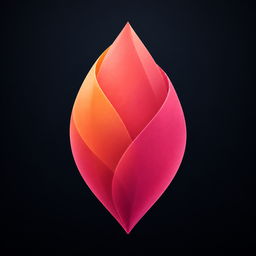
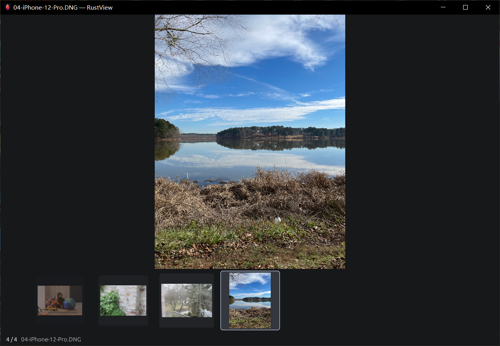
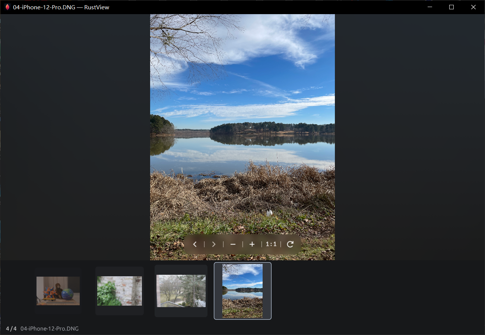
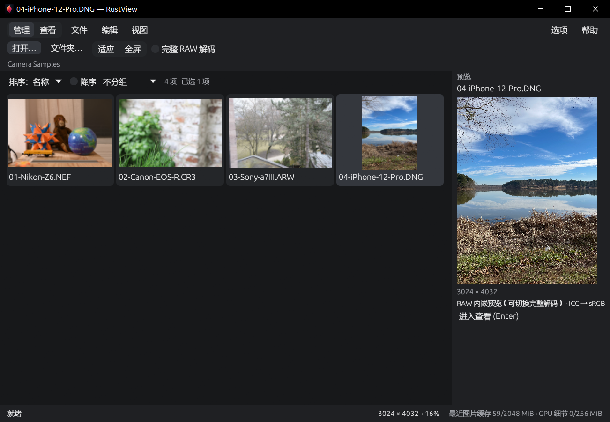
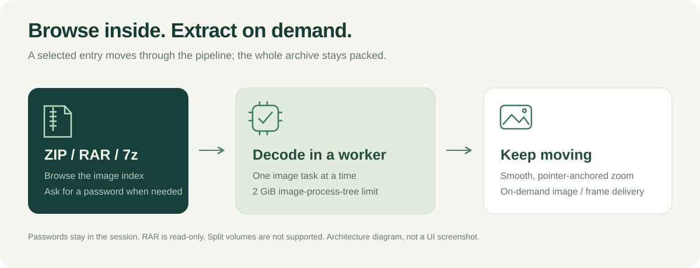
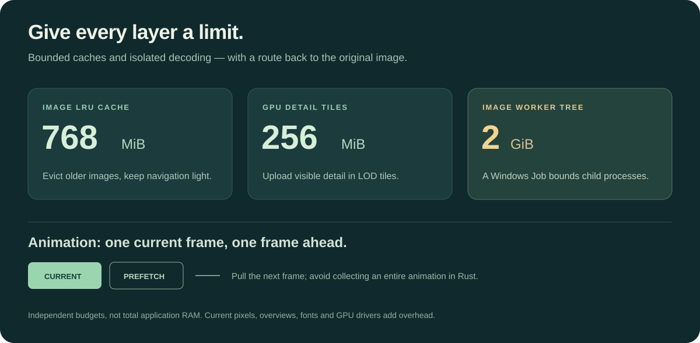

# RustView



[](https://github.com/walker1911/RustView/actions/workflows/ci.yml)

**Open the archive. Keep the flow.**

An archive-first photo viewer for **Windows x64**, written in Rust. Familiar keys, a Picasa-style filmstrip, smooth zoom, camera RAW, Photoshop composites, and pictures inside compressed archives. Read QR codes and copy text from pictures while staying in the viewer.

[Download v0.6.9](https://github.com/walker1911/RustView/releases/tag/v0.6.9) · [简体中文](README.zh-CN.md) · [Compatibility](docs/COMPATIBILITY.md) · [Build guide](BUILDING.md)

## New in v0.6.9

**Select text directly on the image.** Pause on a still image to let offline OCR prepare the text. When the text cursor appears, drag across words or lines and press `Ctrl+C`. Simplified Chinese and English models come with the viewer. Whole-image and selected-area OCR are still available from the right-click menu. [OCR result screenshot](assets/readme/ocr-result.png)

**Zoom into huge local TIFFs.** Open a supported tiled pyramidal TIFF or BigTIFF and start with its embedded overview. Zoom and pan to load only the detail tiles you can see. Very large files open in read-only viewing mode. [Supported TIFF layouts](docs/COMPATIBILITY.md)

**Better Photoshop previews and smoother browsing.** PSD/PSB reads now handle ZIP-compressed composites, including ZIP prediction. If a complex document has no usable composite, RustView can show its embedded JPEG with a preview label. A tap can show a small JPEG directly at full quality. When browsing large local PSD/PSB files, the viewer can show the selected document's own embedded preview while it loads the composite. [v0.6.9 release notes](docs/RELEASE-v0.6.9.md)

## Quiet view



Move the pointer to the top edge or drag the window by its title bar to reveal the menus, file path, and status. The photo and filmstrip stay in place as the controls fade in and out. Move the pointer over the photo to bring up a separate translucent toolbar with previous and next, zoom out and in, actual size, and clockwise rotation. [Menus revealed](assets/readme/viewer-controls.png)

Graphite is the default background. Under **视图 → 看图背景 → 照片柔焦** (View → Background → Photo Soft Focus), the space around the photo takes on a subdued blur drawn from the image. RustView remembers the choice across launches. [Photo Soft Focus screenshot](assets/readme/photo-soft-focus.png)



## Start with the pictures

| Capability | What you can do |
|---|---|
| **Browse archives** | Read ZIP / RAR / 7z images on demand with password prompts, resume from the last image shown, and jump by filename, path, or number. |
| **Reopen recent items** | Return to up to 20 recently opened images, folders, or archives from the File menu. History stays in the local catalog. |
| **Keep browsing** | Left/right changes images and up/down zooms. Tap to load the full image or hold an arrow key for quick previews of uncached local JPEGs and eligible RAWs. A flat, animated filmstrip keeps the selected photo centered, with a filename and `1/84` counter. |
| **View modern formats** | Common images, LibRaw-supported RAW and ProRAW DNG, plus HEIC/HEIF, AVIF, and JPEG XL. |
| **Open Photoshop documents** | View saved PSD/PSB composites locally or inside ZIP/RAR/7z, including sources larger than 512 MiB. Use a labeled embedded preview if the full composite is unavailable and the document includes a usable thumbnail. |
| **Browse huge TIFFs** | View supported local tiled pyramidal TIFF/BigTIFF files using their overview and on-demand detail tiles. |
| **Read QR codes and image text** | Scan the current image for QR codes, drag to select automatically recognized text, or request whole-image and selected-area OCR. [QR support](docs/RELEASE-v0.6.8.md) |
| **Zoom and compare** | Pointer-anchored zoom, panning, visible detail tiles, and up to four linked or independent comparison views. |
| **Play and export animation** | Stream GIF/WebP with timing, disposal, and loop handling; export complete animations. |
| **Work from the source** | RAW adjustments, crop, resize, color, sharpening, text/watermarks, real 16-bit PNG/TIFF, processing records, and presets. |
| **Manage a collection** | Rename previews, folder/XMP moves, ratings, labels, explicit EXIF/IPTC/XMP editing, and contact sheets. |





In single-image view, move the pointer to the top edge and click **跳页…** (Jump to image). Enter part of a filename, the full path inside the archive, or a number starting at 1 in the current browsing order. When filenames repeat, use the path to select the intended entry. In **文件 → 最近打开…** (File → Recent), select an archive to resume or use **从头打开** (Open from start) to begin at its first image. Encrypted archives prompt for the password again when reopened. [Archive resume and jump](docs/RELEASE-v0.6.0.md)

During rapid navigation, RustView can reuse a matching read in progress. Cached images display directly. The previous image's clear overview stays visible, with both images identified, until the target has pixels to show. Opening an individual image starts the read before directory scanning. For a static image opened at launch, the supervised read can also overlap graphics initialization. [Browsing behavior](docs/PICASA-BROWSING.md)

ZIP and 7z updates create a backup. RAR is read-only. RAW metadata uses XMP sidecars.

## Memory has a budget

Decoding uses a separate, memory-limited Windows process tree. Failed records can be bypassed to view the original.

| Resource | Limit |
|---|---:|
| Recent still-image cache for the current folder or archive | 0–2048 MiB, adjustable in Options |
| GPU detail tiles | 256 MiB |
| Image worker process tree | 2 GiB |
| Large TIFF detail worker process tree | 512 MiB |
| OCR process tree | 256 MiB |
| Ordinary input / static RGBA output | 512 MiB each |
| Validated PSD/PSB source, local or archived | 64 GiB; pixel budgets still apply |
| Animation | Current frame + one prefetched frame |

Press `Alt+O` to adjust the recent still-image cache. The initial limit is based on your computer's physical memory. Set it to 0 to disable the cache, or select the recommended value to restore it. Save options to keep the setting across launches.



**Subsystem budgets** exclude GUI, driver, and preview overhead. Oversized inputs may be refused. [Validation details](docs/VALIDATION.md).

v0.4.0 permits [local and ZIP/RAR/7z-contained PSD/PSB](docs/PSD.md) sources up to 64 GiB. It seeks directly to local composites or streams only the selected archive entry to temporary disk and cleans it after the task. RGBA and process-memory budgets remain unchanged. Very large composites can still exceed the pixel budget. Archive extraction needs space for the selected entry plus a 2 GiB reserve; solid archives may take longer to reach it.

## Download and use

1. Download the complete Windows x64 package. [Offline ZIP](https://github.com/walker1911/RustView/releases/download/v0.6.9/RustView-0.6.9-win-x64-offline.zip) · [SHA-256 checksum](https://github.com/walker1911/RustView/releases/download/v0.6.9/RustView-0.6.9-win-x64-offline.zip.sha256)
2. Fully extract it and double-click `RustView.exe` or `Start-RustView.cmd`. The package includes the image engines, runtime libraries, and Tesseract with Simplified Chinese and English models. Viewing and OCR work offline from the first launch.
3. Open or drag in a folder, picture, or archive. Keep the complete extracted folder.

The offline ZIP is the only download needed for viewing. The source guide lists the archives for rebuilding the bundled engines. [Offline guide](OFFLINE.md) · [Native sources](docs/NATIVE-SOURCES.md)

The interface is currently primarily Chinese; a complete English UI is not yet available. See the [full keyboard reference](docs/KEYBOARD.md).

Data stays in `RustView-data` beside the executable. Ordinary viewing needs no PATH or registry changes. Optionally run `Setup-File-Associations.cmd` to register image candidates and an **Open with RustView** context-menu entry for ZIP/RAR/7z. Windows Default Apps confirms image defaults; archive defaults remain unchanged. [Windows integration](docs/WINDOWS-INTEGRATION.md).

### A few familiar keys

Mode-aware bindings distinguish numpad keys and support customization with recognized JSON/REG imports. View arrows do not take over text fields or the management grid. An imported complete legacy shortcut set may need the new arrow bindings added in shortcut settings.

| Action | Default keys |
|---|---|
| Open | `Ctrl+O` |
| Enter View / return to Manage | `Enter` / `Enter`, `Esc`, `Ctrl+W` |
| Previous / next image | `←` / `→`; `PageUp` / `PageDown`; `Backspace` / `Space` |
| Smooth zoom in / out | `↑` / `↓` |
| Zoom / fit / actual pixels | Numpad `+` and `−` / `*` / `/` |
| Pause, resume, or replay GIF/WebP | `G` |
| Rename / compare selection | `F2` / `Ctrl+Alt+R` |
| Properties / shortcut settings | `Alt+Enter` / `Alt+O` |

## Build, test, contribute

Build on Windows x64 with Rust MSVC, C++ Build Tools and Windows SDK, CMake, Ninja, and PowerShell 7. Prepare the pinned image engines and OCR helper first.

```powershell
git clone https://github.com/walker1911/RustView.git
cd RustView
pwsh -File .\tools\fetch-native.ps1
pwsh -File .\tools\build-ocr.ps1
cargo build --release --locked
cargo test --locked -- --test-threads=2
pwsh -File .\tools\build.ps1 -Offline
```

See [BUILDING.md](BUILDING.md) for checksums and validation steps.

Release checks cover static images and archives, GIF/WebP animation, PSD/PSB composites, thumbnails, and large encrypted-RAR cancellation. The v0.6.9 development builds were checked on the Windows desktop for text selection, click-versus-hold browsing, and panning and zooming a 108,199 × 81,503 BigTIFF. [v0.6.9 release notes and measurements](docs/RELEASE-v0.6.9.md) · [Validation results and scope](docs/VALIDATION.md)

Real-camera samples include Nikon Z6, Sony a7 III, Canon EOS R, iPhone 12 Pro ProRAW and HEIC. See the validation record for the scope of native-window, display, and print checks.

[Report an issue](https://github.com/walker1911/RustView/issues) with the version, format/camera, expected behavior, and a minimal reproduction.

## Scope and license

RustView's scope excludes split and self-extracting archives, RAR writing, and imports of ACDSee's private database and development records. Unconfirmed legacy commands stay inactive. Slideshows, calendars, disc burning, online services, and audio/video playback are outside the project scope. [Compatibility limits](docs/COMPATIBILITY.md)

RustView is independent of ACD Systems. Application code is [MIT licensed](LICENSE). Reused components, including the Tesseract OCR engine and its models, retain their licenses. [Third-party notices](THIRD-PARTY-NOTICES.md)
