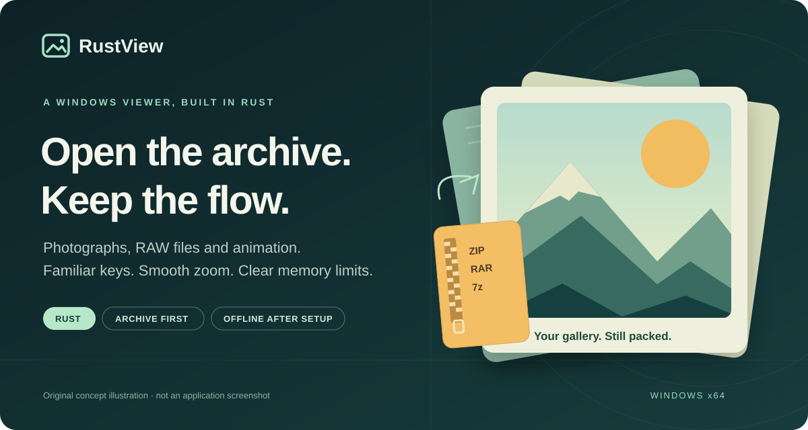
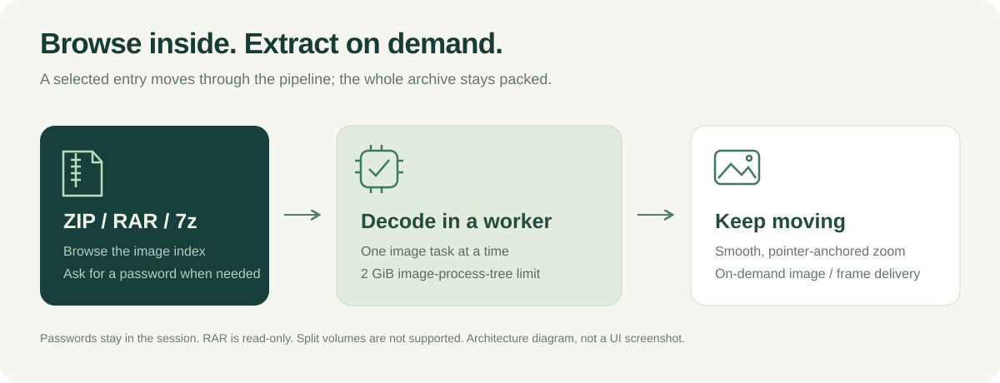
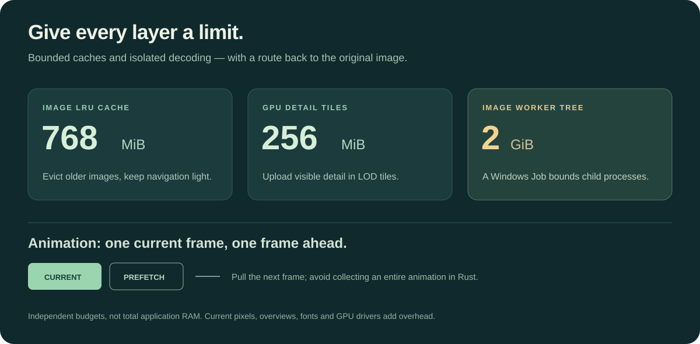

# RustView

[](https://github.com/walker1911/RustView/actions/workflows/ci.yml)

**打开压缩包，接着看。**

面向 **Windows x64** 的 Rust 看图项目。把相机 RAW、GIF/WebP 动画和 ZIP／RAR／7z 里的照片，放进熟悉的键盘翻图与平滑缩放流程。

[下载 v0.3.0](https://github.com/walker1911/RustView/releases/tag/v0.3.0) · [English](README.md) · [兼容说明](docs/COMPATIBILITY.md) · [构建指南](BUILDING.md)



*配图为项目概念图，非真实窗口截图。v0.3 是早期公开版本。*

## 从照片出发

一整个压缩包的照片、一组相机 RAW、一个想仔细看清的动画，都应该能顺手打开。RustView 保留经典桌面看图的操作节奏：打开、翻图、缩放、比较，再继续下一张。

| 能力 | 可以做什么 |
|---|---|
| **直接看包内图片** | 打开 ZIP／RAR／7z，需要时输入密码；按需读取图片，不必先把整个压缩包展开。 |
| **接纳现代格式** | 常见图片、LibRaw 支持的相机 RAW、苹果 ProRAW DNG，以及由内置引擎读取的 HEIC/HEIF、AVIF、JPEG XL。 |
| **平滑缩放与比较** | 保持鼠标指向位置缩放，拖动平移，按可见区域上传细节；最多四图独立或联动查看。 |
| **完整动画** | GIF/WebP 按帧时序、透明合成与循环信息播放；支持整段动画导出。 |
| **从原始源处理** | RAW 调节、裁剪、尺寸、色彩、锐化、文字与水印；导出真正的 16 位 PNG/TIFF，保存处理记录与预设。 |
| **整理与输出** | 批量改名前预览、文件夹与 XMP 伴随迁移、评级和标签、显式读写 EXIF/IPTC/XMP，以及接触表排版。 |



处理步骤保存为记录，常用参数保存为预设。导出会重新读取源数据计算，界面中的 RGBA8 显示预览不作为 RAW／高位输出的来源。

压缩包密码仅用于当前会话。ZIP／7z 改包保留备份，RAR 保持只读。源图元数据与 RustView 自己的目录库分别存储；RAW 元数据写入 XMP 伴随文件。

## 内存有预算，读取按需进行

图像缓存有上限，读取和写入按队列进行；解码超时或超限以错误提示收尾。大图缩放优先上传屏幕可见的分块，减少一次性上传整图的等待。

缓存不会随浏览过的图片无限保留。解码使用独立、受限的 Windows 工作进程树；静态大图按可见范围上传细节，动画保留当前帧和一个预读帧。处理记录恢复失败时，可暂不应用记录而查看原图，记录仍保留。

| 资源 | 上限 |
|---|---:|
| 图像 LRU 缓存 | 768 MiB |
| GPU 细节分块 | 256 MiB |
| 图像工作进程树 | 2 GiB |
| 单文件输入／静态 RGBA 输出 | 各 512 MiB |
| 动画驻留 | 当前帧＋一个预读帧 |



这些是各层预算，**不是整个软件的总内存上限**。字体、驱动、概览纹理等还有额外开销；超限输入可能被拒绝。具体限额和实测范围见[验证记录](docs/VALIDATION.md)。

## 下载与首次准备

1. 下载 [Windows x64 引导包](https://github.com/walker1911/RustView/releases/download/v0.3.0/RustView-0.3.0-win-x64-bootstrap.zip)。
2. 完整解压，运行 `Start-RustView.cmd`。首次准备需要联网：脚本从官方来源获取固定版本的原生引擎，并校验摘要。
3. 依赖准备好后，运行 `RustView.exe` 即可离线看图。打开文件夹、图片、支持的压缩包，也可以直接拖入窗口。

设置、目录库和处理记录保存在程序旁的 `RustView-data` 中。准备脚本不修改全局 PATH、注册表或文件关联。

### 顺手的快捷键

管理、查看、比较模式分别使用对应键位；数字键盘与主键盘数字区分别识别。支持自定义快捷键及可识别的 JSON／REG 配置导入。

| 操作 | 默认按键 |
|---|---|
| 打开 | `Ctrl+O` |
| 进入查看／返回管理 | `Enter`／`Enter`、`Esc`、`Ctrl+W` |
| 上／下一张 | `PageUp`／`PageDown`；`Backspace`／`Space` |
| 缩放／适应／实际像素 | 数字键盘 `+`、`−`／`*`／`/` |
| GIF/WebP 暂停、继续、重播 | `G` |
| 重命名／比较所选图片 | `F2`／`Ctrl+Alt+R` |
| 属性／快捷键选项 | `Alt+Enter`／`Alt+O` |

完整默认键位见[快捷键参考](docs/KEYBOARD.md)。当前界面主要为中文；英文介绍不代表已经提供完整英文界面。

## 从源码构建

需要 Windows x64、Rust MSVC 工具链、包含 Windows SDK 的 C++ Build Tools，以及 PowerShell 7。测试、打包前先获取固定版本的原生引擎：

```powershell
git clone https://github.com/walker1911/RustView.git
cd RustView
pwsh -File .\tools\fetch-native.ps1
cargo build --release --locked
cargo test --locked -- --test-threads=2
pwsh -File .\tools\build.ps1
```

依赖、校验和与复现步骤见 [BUILDING.md](BUILDING.md)。

## 验证到哪一步

v0.3 公开源码现有 **159 项单元测试通过**，另有 2 项公开样本测试默认跳过；本地发行基线为 **68 项工作进程回归通过**。[Windows-2022 干净检出的 CI 运行](https://github.com/walker1911/RustView/actions/runs/42846831762)也已通过单测、构建，以及 **49 项工作进程回归**：25 项静态图／压缩包、24 项动画。真实相机样本在本地验证，覆盖 Nikon Z6、Sony a7 III、Canon EOS R、iPhone 12 Pro ProRAW 和 HEIC，不能推广到所有机型、固件与编码。

Windows 拒绝了 GUI 自动化访问，因此真实窗口交互、全部视觉布局和实际纸张打印尚未完整验收。项目仍处于早期公开阶段，完整证据与局限见[验证记录](docs/VALIDATION.md)。欢迎在 [Issues](https://github.com/walker1911/RustView/issues) 提供版本、格式／相机型号、预期行为和最小复现样本。

## 保持清楚的边界

不支持分卷、自解压包或 RAR 写入；不导入 ACDSee 私有数据库与开发记录，未确认语义的旧命令保持停用。幻灯片、日历、刻录篮子、在线服务与音视频播放不在项目范围内。详细行为差异见[兼容说明](docs/COMPATIBILITY.md)。

RustView 是独立项目，与 ACD Systems 无隶属关系。应用代码采用 [MIT 许可](LICENSE)；界面与解码复用 egui/wgpu、image、LibRaw、7-Zip、ImageMagick、ExifTool，各原生引擎保留自己的许可，详见[第三方声明](THIRD-PARTY-NOTICES.md)。
