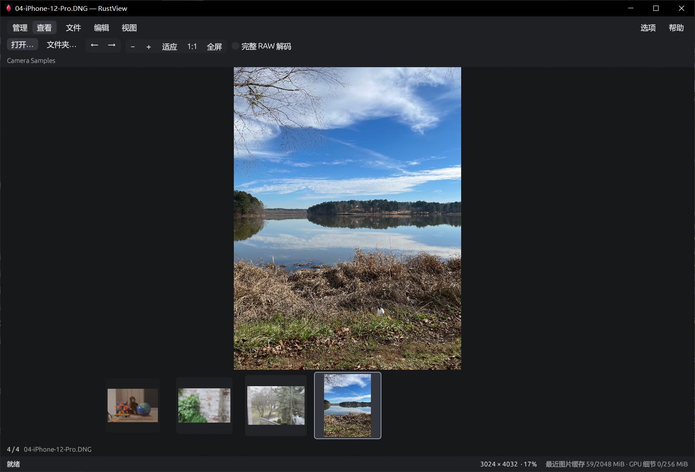

# RustView v0.6.3 / 更新说明

## 中文

- **石墨配色与更清楚的布局。** 在顶部切换管理和查看模式。常用工具按操作分组，目录和缩略图用柔和底色标出选择，长路径可悬停查看。
- **按住方向键连续预览。** 浏览本地 JPEG 时，左右键长按优先显示目标图自己的低清预览，松键后完成清晰图。目标预览就绪前暂时保留上一张的清晰概览。符合条件的 JPEG 使用 Windows 缩小解码，按设置处理 ICC 色彩并保留 EXIF 方向。其他 JPEG 走常规受限解码。
- **双击静态图后尽早开始解码。** 受限工作进程可与图形初始化并行，目录库和中文字体延后到首张图片绘制后准备。读取仍按已保存的色彩和缓存设置进行。

### 性能实测

在同一台 Windows 电脑的 10,000 张 JPEG 目录中，v0.6.2 和界面改版前的 v0.6.3 性能候选版各暖机一次、计时五次。连翻按键间隔为 55 ms，表中取中位数。

| 指标 | v0.6.2 | v0.6.3 性能候选版 |
|---|---:|---:|
| 向右连翻，末次按键到目标图可见 | 169 ms | 61 ms |
| 向左连翻，末次按键到目标图可见 | 69 ms | 61 ms |
| 启动到首图可见 | 950 ms | 954 ms |

下载 Windows x64 完整离线 ZIP，完整解压后双击 `RustView.exe` 或 `Start-RustView.cmd`。7-Zip、LibRaw、ImageMagick、ExifTool 和 VC++ 运行库随包提供，首次启动可离线。迁移到新目录时，关闭程序后可复制旧程序旁的 `RustView-data`，带上已有设置、目录库和处理记录。[离线 ZIP](https://github.com/walker1911/RustView/releases/download/v0.6.3/RustView-0.6.3-win-x64-offline.zip) · [SHA-256 校验文件](https://github.com/walker1911/RustView/releases/download/v0.6.3/RustView-0.6.3-win-x64-offline.zip.sha256)

## English

- **Graphite theme and clearer controls.** Switch between Manage and View from the top bar. Related actions sit together, selected folders and thumbnails use a soft fill, and long paths are available on hover.
- **Hold an arrow to skim JPEGs.** Holding Left or Right while browsing local JPEGs prioritizes a low-resolution preview of the selected image. Release the key to finish loading the full-quality image. A clear overview of the previous picture stays visible while the target preview loads. Eligible JPEGs use scaled Windows decoding with EXIF orientation and ICC color handling according to the viewer's settings. Other JPEGs follow the regular supervised decoding path.
- **Start decoding a static picture earlier.** The supervised image worker can run while graphics initialize. The catalog and Chinese fonts are deferred until after the first image draws. Decoding follows the saved color and cache settings.

### Performance sample

The same Windows PC ran v0.6.2 and the v0.6.3 performance candidate from before the interface refresh against a 10,000-JPEG directory. Each build had one warmup and five timed runs with 55 ms key repeats. Values are medians.

| Measurement | v0.6.2 | v0.6.3 performance candidate |
|---|---:|---:|
| Browse right, final keydown to visible target | 169 ms | 61 ms |
| Browse left, final keydown to visible target | 69 ms | 61 ms |
| Launch to first visible photo | 950 ms | 954 ms |

Download the complete Windows x64 offline ZIP, extract it fully, and double-click `RustView.exe` or `Start-RustView.cmd`. The package includes 7-Zip, LibRaw, ImageMagick, ExifTool, and app-local VC++ runtime libraries for offline use from first launch. To carry your settings, catalog, and processing records to a new folder, close RustView and copy `RustView-data` from beside the previous executable. [Offline ZIP](https://github.com/walker1911/RustView/releases/download/v0.6.3/RustView-0.6.3-win-x64-offline.zip) · [SHA-256 checksum](https://github.com/walker1911/RustView/releases/download/v0.6.3/RustView-0.6.3-win-x64-offline.zip.sha256)

[上个版本 / Previous release](https://github.com/walker1911/RustView/releases/tag/v0.6.2) · [离线版说明 / Offline guide](https://github.com/walker1911/RustView/blob/v0.6.3/OFFLINE.md) · [原生引擎源码 / Native sources](https://github.com/walker1911/RustView/blob/v0.6.3/docs/NATIVE-SOURCES.md) · [示例图像 / Demo image credits](https://github.com/walker1911/RustView/blob/v0.6.3/assets/readme/README.md)
