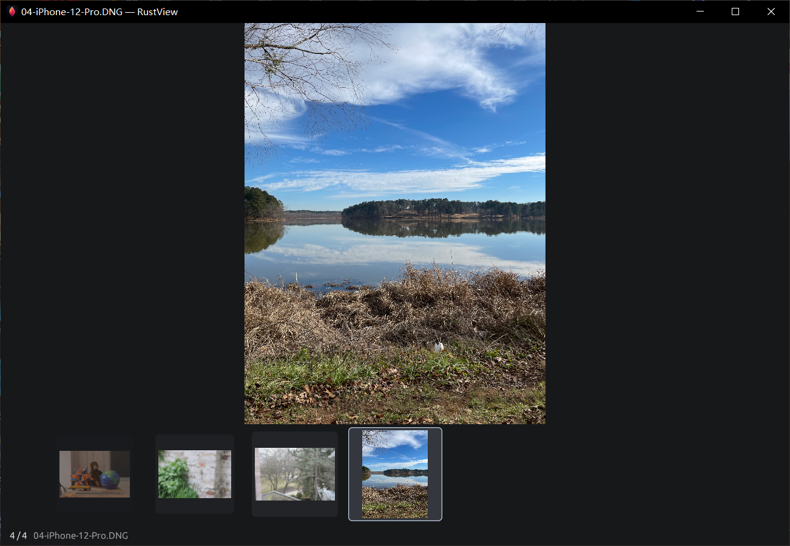

# RustView v0.6.7 / 更新说明

## 中文

- **清爽看图。** 双击图片后，默认显示照片和可用的底部缩略图。将鼠标移到窗口顶边或拖动标题栏，顶部菜单、文件路径和底部状态栏会淡入。下拉菜单打开时保持显示，拖动松手后短暂停留再淡出。界面显隐时，照片和缩略图保持原位。
- **石墨灰与照片柔焦。** 默认使用石墨灰。可在「视图 → 看图背景」切换到「照片柔焦」，用取自照片的低饱和模糊填充周围留白。背景使用有大小上限的预览纹理，选择会保存到下次启动。
- **半透明浮动工具栏。** 在照片上移动鼠标，胶片带上方会浮现上一张、下一张、缩小、放大、原始尺寸和顺时针旋转按钮。指针停在按钮上时可继续操作，离开后工具栏会自动收起。

### Windows 实测

在 125% 缩放的 Windows 桌面上，验证了默认界面、菜单保持打开、拖动窗口与松手后淡出，以及缩小窗口时的行为。对比显隐前后的截图，照片主体与胶片带检测区域像素一致。照片柔焦只改变周围留白，重启后仍保留选择。程序通过 241 项单元测试。

下载 Windows x64 完整离线 ZIP，完整解压后双击 `RustView.exe` 或 `Start-RustView.cmd`。包内包含 7-Zip、LibRaw、ImageMagick、ExifTool 和 VC++ 运行库，首次启动即可离线看图。换到新目录时，关闭 RustView 后可复制旧程序旁的 `RustView-data`，带上设置、快捷键、目录库和处理记录。[下载离线 ZIP](https://github.com/walker1911/RustView/releases/download/v0.6.7/RustView-0.6.7-win-x64-offline.zip) · [SHA-256 校验文件](https://github.com/walker1911/RustView/releases/download/v0.6.7/RustView-0.6.7-win-x64-offline.zip.sha256)

## English

- **Quiet view.** A photo opens with the filmstrip when neighboring images are available. Move the pointer to the top edge or drag the title bar to reveal the menus, file path, and status. Open menus stay visible. The controls linger briefly after a drag and then fade. The photo and filmstrip stay in place throughout.
- **Graphite and Photo Soft Focus.** Graphite is the default. Choose **视图 → 看图背景 → 照片柔焦** (View → Background → Photo Soft Focus) for a subdued blur in the space around the photo. The blur uses a small, bounded preview texture, and the background choice is remembered across launches.
- **Translucent floating toolbar.** Move the pointer over the photo to reveal previous and next, zoom out and in, actual size, and clockwise rotation above the filmstrip. The toolbar stays visible while the pointer is over its buttons and fades out when you move away.

### Windows validation

Desktop checks at 125% scaling covered the default view, open menus, window dragging and fade after release, and behavior at minimum window size. Pixel comparisons matched across the sampled photo and filmstrip areas before and after the controls appeared. Photo Soft Focus changed the surrounding space and persisted after restarting. The build passed 241 unit tests.

Download and fully extract the complete Windows x64 offline ZIP, then double-click `RustView.exe` or `Start-RustView.cmd`. The package includes 7-Zip, LibRaw, ImageMagick, ExifTool, and app-local VC++ runtime libraries for offline use from the first launch. When moving to a new folder, close RustView and copy `RustView-data` from beside the old executable to carry over settings, shortcuts, the catalog, and processing records. [Download offline ZIP](https://github.com/walker1911/RustView/releases/download/v0.6.7/RustView-0.6.7-win-x64-offline.zip) · [SHA-256 checksum](https://github.com/walker1911/RustView/releases/download/v0.6.7/RustView-0.6.7-win-x64-offline.zip.sha256)

[菜单浮现 / Menus revealed](https://github.com/walker1911/RustView/blob/v0.6.7/assets/readme/viewer-controls.png) · [浮动工具栏 / Floating toolbar](https://github.com/walker1911/RustView/blob/v0.6.7/assets/readme/floating-toolbar.png) · [照片柔焦 / Photo Soft Focus](https://github.com/walker1911/RustView/blob/v0.6.7/assets/readme/photo-soft-focus.png) · [离线版说明 / Offline guide](https://github.com/walker1911/RustView/blob/v0.6.7/OFFLINE.md) · [上个公开版本 / Previous public release](https://github.com/walker1911/RustView/releases/tag/v0.6.5)
