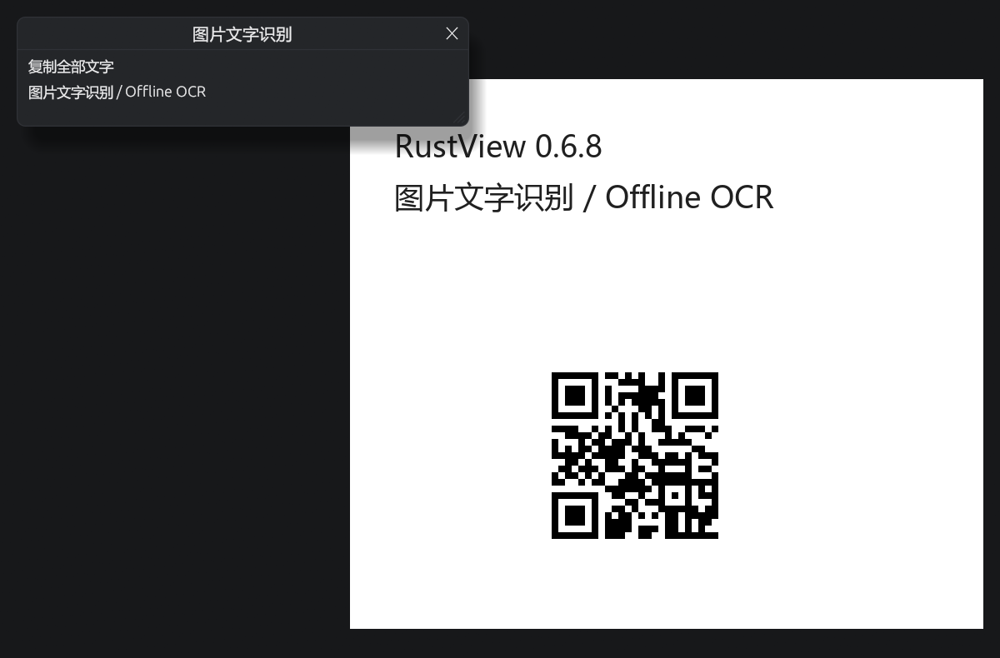

# RustView v0.6.8 · 自动扫码与离线 OCR / Automatic QR and offline OCR

## 中文

- **看图时自动读二维码。** 当前图片稳定显示后，后台用已有预览扫描。识别成功时，右下角出现「二维码」按钮，点开可查看或复制内容。网页链接会显示域名，由你点选打开。较小的二维码可通过右键「框选二维码…」用更清晰的像素重扫。
- **离线识别整图或选区文字。** 右键选择「识别整图文字（OCR）」或「框选文字（OCR）…」，可识别简体中文、英文和中英混排。结果可选取或整段复制。识别引擎和模型随包提供，图片在本机处理。
- **识别任务按需运行。** 扫码等待图片停留约 350 毫秒并避开前台读取，翻图时清理旧结果。OCR 由用户发起，使用可取消的独立进程，工作进程的内存限额为 256 MiB，识别超时为 20 秒。整图 OCR 可能把密集图案读成文字，框选文字区域可避开图案。

### Windows 实测

用 v0.6.7 与发布前的 v0.6.8 构建在同一台 Windows 电脑上交替测试。表中为中位数，单位为毫秒。RAR、7z 的大 PSD 在实际窗口中计时。AES ZIP 计时来自独立解码工作进程。

| 测试项目 | v0.6.7 | v0.6.8 |
|---|---:|---:|
| 万张 JPEG 图库首图显示 | 624 | 633 |
| 万张 JPEG 图库长按翻图，目标预览显示 | 70 | 70 |
| 相机 RAW 首图显示 | 619 | 609 |
| 相机 RAW 长按翻图，目标预览显示 | 78 | 61 |
| 相机 RAW 松键到清晰画面 | 402 | 428 |
| 加密 RAR 中的 521 MiB PSD 选中后显示 | 682 | 675 |
| 加密 7z 中的 521 MiB PSD 选中后显示（含预读） | 50 | 50 |
| 加密 ZIP 中的 521 MiB PSD 解码 | 1,117 | 1,118 |

万张 JPEG 和 RAW 浏览的采样峰值分别为 583 → 558 MiB 和 610 → 601 MiB，统计应用及子进程的私有提交内存。完成的桌面测试没有采样到空白帧，退出后没有残留进程或临时文件。另在 OCR 进程运行中关窗，程序正常退出，进程和临时文件均已清理。

### 下载与运行

完整解压 Windows x64 离线 ZIP，再双击 `RustView.exe` 或 `Start-RustView.cmd`。随包提供 7-Zip、LibRaw、ImageMagick、ExifTool、VC++ 运行库、Tesseract 和简体中文及英文模型。首次启动即可离线看图、扫码和识别文字。更换目录时，可关闭 RustView 后复制旧程序旁的 `RustView-data`，保留设置、快捷键、目录库和处理记录。[离线 ZIP](https://github.com/walker1911/RustView/releases/download/v0.6.8/RustView-0.6.8-win-x64-offline.zip) · [SHA-256 校验文件](https://github.com/walker1911/RustView/releases/download/v0.6.8/RustView-0.6.8-win-x64-offline.zip.sha256)

## English

- **Read QR codes while browsing.** When a picture has been on screen briefly, RustView scans the existing preview in the background. A QR button appears at the lower right when it finds a code. Open the result to view or copy its content. For web links, RustView shows the domain and opens the link when you choose. Small codes can be rescanned from a selected area.
- **Recognize text in a whole image or selection offline.** Right-click and choose **识别整图文字（OCR）** (Recognize text in the whole image) or **框选文字（OCR）…** (Select a text area). Select text in the result or copy it all. The package includes the engine and models for Simplified Chinese, English, and mixed text. Image processing stays on your PC.
- **Run recognition when needed.** QR scanning waits roughly 350 ms and yields to foreground reads. Old results are cleared as you browse. OCR starts on request in a cancellable process with a 256 MiB memory limit and a 20-second timeout. Dense patterns can produce false characters in whole-image OCR. Selecting the text area helps avoid those patterns.

### Windows validation

The same Windows PC alternated v0.6.7 and a pre-release v0.6.8 build. The table shows medians in milliseconds. RAR and 7z timings come from the actual window. The AES ZIP timing comes from the isolated decode worker.

| Measurement | v0.6.7 | v0.6.8 |
|---|---:|---:|
| First image in a 10,000-JPEG folder | 624 | 633 |
| Selected JPEG preview while holding an arrow key | 70 | 70 |
| First camera RAW image | 619 | 609 |
| Selected RAW preview while holding an arrow key | 78 | 61 |
| RAW arrow release to clear image | 402 | 428 |
| Selection to display of a 521 MiB PSD in encrypted RAR | 682 | 675 |
| Selection to display of a 521 MiB PSD in encrypted 7z, with prefetching | 50 | 50 |
| Decode of a 521 MiB PSD in encrypted ZIP | 1,117 | 1,118 |

Sampled process-tree private commit peaked at 583 → 558 MiB for JPEG browsing and 610 → 601 MiB for RAW browsing. Completed desktop tests sampled zero blank frames and left no processes or temporary files after closing. Closing while OCR was active also exited normally and cleaned up the process and temporary files.

### Download and run

Fully extract the Windows x64 offline ZIP, then double-click `RustView.exe` or `Start-RustView.cmd`. The ZIP contains 7-Zip, LibRaw, ImageMagick, ExifTool, app-local VC++ libraries, and Tesseract with Simplified Chinese and English models. Viewing, QR detection, and OCR work offline from the first launch. When moving to a new folder, close RustView and copy `RustView-data` from beside the old executable to carry over your settings, shortcuts, catalog, and processing records. [Offline ZIP](https://github.com/walker1911/RustView/releases/download/v0.6.8/RustView-0.6.8-win-x64-offline.zip) · [SHA-256 checksum](https://github.com/walker1911/RustView/releases/download/v0.6.8/RustView-0.6.8-win-x64-offline.zip.sha256)

[二维码 / QR result](https://github.com/walker1911/RustView/blob/v0.6.8/assets/readme/qr-recognition.png) · [OCR 框选 / OCR selection](https://github.com/walker1911/RustView/blob/v0.6.8/assets/readme/ocr-selection.png) · [离线版说明 / Offline guide](https://github.com/walker1911/RustView/blob/v0.6.8/OFFLINE.md) · [上个版本 / Previous release](https://github.com/walker1911/RustView/releases/tag/v0.6.7)
